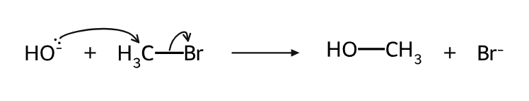
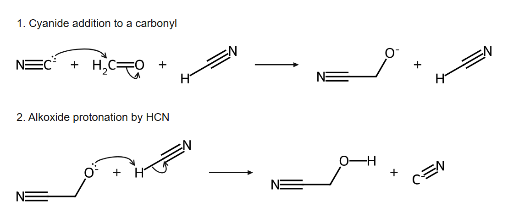

# Organic Chemistry Review

[中文](README.md) · [Download a skill bundle](https://github.com/liuguangyu272/organic-chem-review/releases/latest)

An undergraduate organic chemistry Agent Skill combining **slide-ordered tutoring, active recall, targeted error review, and code-generated molecular and mechanism diagrams**. Chinese is the default teaching language; users can request English.



The mechanism core is an MIT-licensed source subset from [LaoZhong-Mihari/codex-organic-chem](https://github.com/LaoZhong-Mihari/codex-organic-chem). This project adds the learning workflow, slide-order guidance, structure-rendering helper, portable packaging and regression checks. [Attribution](THIRD_PARTY_NOTICES.md)

## Ordinary Chat: session attachments

Download `CHAT_START.md` and `organic-chem-review-chat-v1.1.0.zip` from the latest release. Attach both and your slides, then explicitly ask the assistant to follow `CHAT_START.md`. Ask for English if preferred.

The standalone document provides slide order, feedback and one-question-at-a-time review. If that chat can execute Python, it should extract the archive, load the full instructions and run `session_probe.py` before claiming working chemistry tools. Without execution or dependencies, it must disclose that limitation and can still provide the tutoring workflow. Uploading files does not enable tools, install an account-wide skill, or synchronize a local environment. If the upload surface rejects ZIPs, use the standalone instructions and the capabilities actually present.

Local tests cover extracting the attachment package, executing its probe and accurately reporting missing dependencies. An actual end-to-end run inside the user's ordinary Chat session is **not** established by those tests.

## Work / native skill installation

With [Skills CLI](https://github.com/vercel-labs/skills), using Node.js 22.20 or newer:

```bash
npx skills add liuguangyu272/organic-chem-review --skill organic-chem-review
```

Choose an agent; add `-g` for a personal installation. Alternatively, download the release ZIP and copy its entire `organic-chem-review` folder into your agent's skill directory:

| Host | Common personal directory |
| --- | --- |
| Codex / ChatGPT desktop local-skill workflows | `~/.agents/skills/` |
| Cursor | `~/.agents/skills/` or `~/.cursor/skills/` |
| Claude Code | `~/.claude/skills/` |

Keep supporting files. Local installation does not automatically synchronize to web/cloud sessions. Availability, permissions and clickable-card rendering depend on the host. The fallback is one question per chat turn.

## Use

Attach your slides and invoke the skill:

```text
Use organic-chem-review. Start on slide 8 and preserve the original slide order.
Explain in English, generate structures with code, and ask one question at a time.
Do not reveal the answer until I attempt it or ask for it.
```

The skill tracks the current slide in the conversation, inserts only necessary prerequisites, corrects factual errors, and tests a changed condition after an error. It does not assume cross-chat memory. There is no project-operated collection server; your host handles your attachments and conversations.

New runtime environments must run the actual probe, not infer tool access from an installed skill. Default pacing is one concept on the current slide and one question before waiting for the learner. User requests for longer explanations or batch tests override this default.

## Chemistry tools

Use a dedicated Python environment and install RDKit:

```bash
python -m venv .venv
# Use .venv/Scripts/python on Windows or .venv/bin/python on macOS/Linux:
python -m pip install -r skills/organic-chem-review/scripts/requirements.txt
python skills/organic-chem-review/scripts/render_structures.py --smiles "CC(=O)O" --label "A" --output work/acid
python skills/organic-chem-review/scripts/session_probe.py --output work/session-check
python skills/organic-chem-review/scripts/mechanism_tools.py --example sn2 --output work/sn2
```

Replace `python` above with the virtual environment's executable. Molecule output includes SVG, PNG and an audit record. Mechanism output includes SVG, an explicit spec, checks, a step trace and CDXML. Optional `--png` uses a local headless Edge/Chrome/Chromium with a temporary profile; SVG works without a browser.



## Verification and boundaries

Initial local checks used Windows, Python 3.14 and RDKit 2026.09.2: aromaticity, formal charge, R/S, E/Z, unspecified chirality, invalid valence, five curated mechanism classes and seven deliberately inconsistent mechanisms. Embedded specs and traces round-trip exactly. The two displayed mechanism PNGs were visually inspected.

```bash
python -m unittest discover -s tests -v
python scripts/build_release.py
```

Checks cover supported electron bookkeeping and geometric consistency, not experimental truth, kinetics or general mechanism discovery. Every intermediate must be supplied. Some stereochemical/isotope mechanisms are blocked rather than drawn inaccurately. CDXML native-editor round-trip fidelity and independent educational outcomes are not established.

## Contribute

Report reproducible errors with input, expected output, actual output and environment versions. Do not upload personal information or slides you cannot redistribute. Small, anonymized teaching examples and documentation improvements are welcome.

[MIT license](LICENSE). Preserve [third-party notices](THIRD_PARTY_NOTICES.md) when redistributing.
