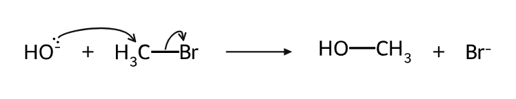
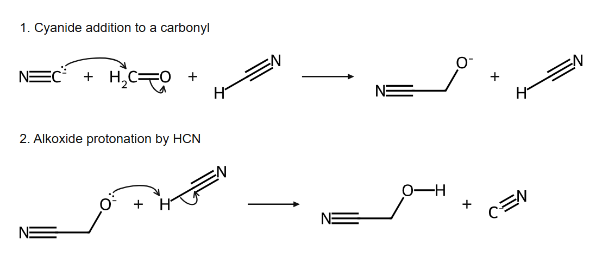

# 有机化学复习搭子 · Organic Chemistry Review

[English](README.en.md) · [下载技能包](https://github.com/liuguangyu272/organic-chem-review/releases/latest) · [技能规则](skills/organic-chem-review/SKILL.md)

面向本科生的有机化学 Agent Skill：**按 PPT 页序讲解，用代码生成结构式与分步机理，通过逐题问答和错题变式检验理解。** 默认中文，英文术语首次解释。



图中结构与电子弯箭由程序生成，不是 AI 插画。机理核心复用了 [LaoZhong-Mihari/codex-organic-chem](https://github.com/LaoZhong-Mihari/codex-organic-chem) 的 MIT 许可模块；本项目增加复习流程、PPT 页序规则、结构生成脚本及可移植包装。[来源与边界](THIRD_PARTY_NOTICES.md)

## 能做什么

- **按课件复习**：标明当前页，必要前置知识就地补充，随后回到原页序；指出课件中的化学错误。
- **主动回忆**：一次一题，先作答后解析；提示逐级提供，区分结论正确与推理正确。
- **错题迁移**：围绕具体错误改变底物、溶剂、位阻或构象，检验是否真正理解。
- **结构生成**：SMILES → RDKit 校验 → SVG/PNG，保留电荷和已指定的立体信息。
- **显式分步机理**：根据已给出的中间体与原子映射，检查电子流、键级、电荷和守恒，再渲染弯箭。

## 安装

通过 [Skills CLI](https://github.com/vercel-labs/skills) 安装；需要 Node.js 22.20 或更新版本：

```bash
npx skills add liuguangyu272/organic-chem-review --skill organic-chem-review
```

选择目标助手。默认安装到当前项目；加 `-g` 可安装为本机个人技能。也可下载 Release 中的 ZIP，把完整的 `organic-chem-review` 文件夹放到对应目录：

| 环境 | 常见安装目录 |
| --- | --- |
| Codex / 支持本地技能的 ChatGPT 桌面端 | `~/.agents/skills/` |
| Cursor | `~/.agents/skills/` 或 `~/.cursor/skills/` |
| Claude Code | `~/.claude/skills/` |

保留 `references`、`scripts`、`assets` 等配套文件，不要只复制 `SKILL.md`。网页和云端会话不会因此自动获得本机技能或执行环境；入口和运行权限以所在产品为准。原生点击卡片可用性取决于客户端，不支持时采用逐题对话。

## 开始复习

上传自己的 PPT 或按页导出的 PDF，调用已安装的技能：

```text
使用 organic-chem-review，从第 8 页开始，按 PPT 原顺序复习。
结构式和机理图优先通过代码生成。
每次一个知识点，再出一道题，先不要给答案。
```

也可以直接说：“比较 SN1 和 SN2，先解释我错在哪里，再出一道条件变化题。”课件与作答留在你所用助手的会话中，本项目不提供数据收集服务器。

## 运行化学工具

教学规则不要求你会写代码；结构和机理脚本需要可执行 Python 的环境。在仓库根目录创建独立环境：

```bash
python -m venv .venv
# Windows:
.venv\Scripts\python -m pip install -r skills/organic-chem-review/scripts/requirements.txt
# macOS / Linux:
.venv/bin/python -m pip install -r skills/organic-chem-review/scripts/requirements.txt
```

下面命令中的 `python` 请替换成上面虚拟环境的 Python：

```bash
python skills/organic-chem-review/scripts/render_structures.py --smiles "CC(=O)O" --label "A" --output work/acetic-acid
python skills/organic-chem-review/scripts/mechanism_tools.py --example sn2 --output work/sn2
python skills/organic-chem-review/scripts/mechanism_tools.py --example carbonyl_addition --output work/addition --png
```

机理输出包含 SVG、规格、检查与逐步追踪记录，以及 CDXML 交换文件；`--png` 可选，需要本地 Edge/Chrome/Chromium。没有浏览器也能生成 SVG。编写新机理前阅读[工具工作流](skills/organic-chem-review/references/mechanism-workflow.md)。



## 验证与限制

已在 Windows、Python 3.14、RDKit 2026.09.2 下检查：

- 芳香环、电荷、R/S、E/Z、未指定构型及非法价态输入。
- 5 类教学机理示例：SN2、质子转移、羰基加成后质子化、E2、成对均裂。
- 7 类错误机理被拦截，以及规格、追踪记录与摘要的往返一致性。
- SN2 与两步羰基加成生成的 PNG 已目视检查。

运行可复现的软件检查：

```bash
python -m unittest discover -s tests -v
python scripts/build_release.py
```

这不是通用机理发现引擎。中间体与条件仍需正确提供；通过检查只代表支持范围内的电子记账与布局一致，不证明该路径在实验中真实发生。当前机理画布对部分立体/同位素表达会拒绝输出；普通二维立体结构可由独立结构脚本展示。CDXML 尚未验证在 ChemDraw 中的完整往返编辑。

PPT 按页教学和长期学习效果尚无独立用户研究；不宣称提升成绩的统计结论，也不默认跨聊天保存学习记录。

## 反馈与贡献

欢迎提交可复现的错图、错误机理判定、匿名化教学案例和安装问题。请附输入、预期结果、实际结果及 Python/RDKit 版本；先移除个人信息和无权公开的课件内容。改动机理代码时，请保留上游许可与来源。

原创部分采用 [MIT](LICENSE) 许可；上游模块的许可和提交记录见 [THIRD_PARTY_NOTICES.md](THIRD_PARTY_NOTICES.md)。
